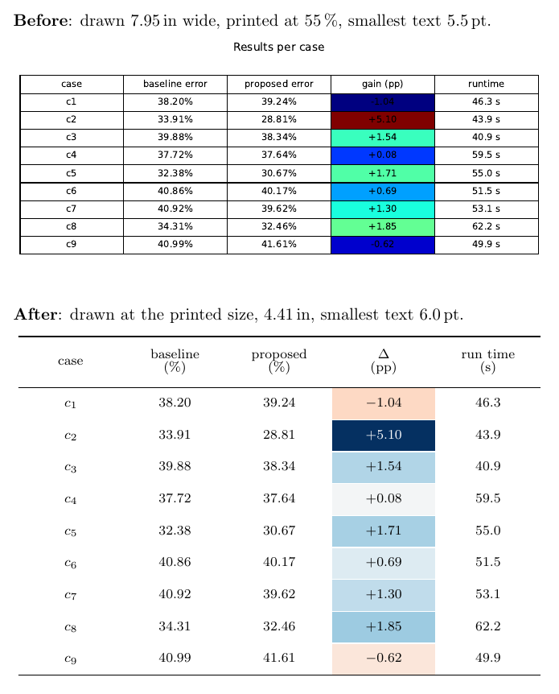

# braindance

A plotting agent that turns raw data into publication-quality figures. It is a [Claude Code](https://claude.com/claude-code) plugin: a skill that sets the house style, a checker that compares every plotted value with its source file, and a reviewer agent that reads the result before it is handed over.

## What it does

- **House style.** All text and numbers in LaTeX (Computer Modern), figures created at the printed column width, colourblind-safe colours, vector PDF.
- **Measured checks** (`check_figure.py`). The values drawn equal the values in the source files, every declared series is in the figure, no point is hidden by axis limits or a log axis. It also measures width, font sizes, overlapping text, legends or labels sitting on data, colormaps, and the fonts and page size of the saved PDF.
- **Manuscript projects** (`figproject.py`). Point it at the main `.tex` file: it compiles the preamble to measure the text width, `\linewidth` in `figure` and `figure*`, and the font sizes, then records every figure with the width it is printed at in `figures.yaml`, and writes `FIGURES.md`, an index of the figures with their captions. Plotting scripts take their width and shared colours from the record, and every check result is written back to it. Two commands show the result: `compare` (each current figure next to its new version at print size) and `preview` (the manuscript compiled with the new figures, nothing overwritten).
- **Chart choice** (`chart-choice.md`). Which chart suits which data and the rules that hold for any chart, adapted from [From Data to Viz](https://www.data-to-viz.com).
- **Review loop** (`figure-reviewer`). A separate agent looks at the rendered figure, the script and the check report, and returns PASS or a ranked list of fixes, for up to three rounds.

## Before and after

Four figures of a small synthetic manuscript, first as many drafts are drawn (matplotlib defaults, a large canvas shrunk to `\linewidth` by LaTeX), then redrawn from the same data with braindance. Each image shows the old figure above the new one, both at the width the manuscript prints them, so text sizes compare as a reader sees them on the page. All four new versions pass the measured checks with no warnings, including the comparison of every plotted value with its data. The data are synthetic; [`docs/examples/`](docs/examples/) has the scripts, and `python docs/examples/build.py` rebuilds everything.

**Multi-panel overview.** Drawn 12.4 in wide and printed at 51 %, the original's smallest text is 5.1 pt. The new version is drawn at the printed width. It replaces the rainbow colormap with a perceptually uniform one and draws the fields at the true aspect ratio of the domain. One encoding runs through every panel: heating ratio as colour and marker, Reynolds number as line style, validation cases in black. A single legend replaces the one covering the profiles, and the cases are labelled on the points.


**Convergence study.** The new version puts ticks at the grid sizes that were run instead of a single 10², and labels the reference slopes on the lines. They are offset so they no longer hide the data. The legend states that the bars are the range over five runs. LaTeX text replaces the plain-text `L2 error` and the axes title.


**Table with colour.** The original is a matplotlib table printed at 55 % with a rainbow fill. The new version is set like a table in the paper: units in the headers instead of a % sign in every cell, rules instead of a grid, and case names typeset as in the text. The gain is coloured on a diverging scale centred on zero, so losses and gains read at a glance.



**Paired heatmaps.** The original gives each panel its own rainbow scale, so the same colour means different values in the two maps: green is about +5 in model A and about −5 in model B. The new version uses one diverging scale centred on zero for both, which shows that model B loses to the baseline at small widths. Each panel is named in its heading rather than in the axis label.


## Install

Requires Python with numpy, matplotlib and PyYAML. A LaTeX installation is used when present (otherwise matplotlib's mathtext with Computer Modern), and poppler-utils (`pdffonts`, `pdfinfo`) for the PDF checks.

Inside Claude Code (2.1.275 or later):

```
/plugin install braindance --marketplace gbareas/braindance
```

Or from the shell:

```bash
claude plugin marketplace add gbareas/braindance
claude plugin install braindance@braindance
```

Then ask Claude Code for a figure; the skill loads as `braindance:latex-scientific-plots`. To try a local checkout without installing: `claude --plugin-dir /path/to/braindance`.

## Layout

- `skills/latex-scientific-plots/` - the skill: `SKILL.md`, the style file, `check_figure.py`, `figproject.py`, `chart-choice.md` and a worked example with its data
- `agents/figure-reviewer.md` - the reviewer
- `tests/` - `python tests/test_check_figure.py` and `python tests/test_figproject.py`
- `docs/` - analysis and design notes; `docs/examples/` - the synthetic before-and-after examples above (`build.py` rebuilds them)

## Roadmap

- **0.1** (this version) - skill and reviewer packaged as a plugin; data and style checks; chart-choice rules
- **0.2** - done so far: the per-manuscript figure record (`figures.yaml`) with target sizes measured from the LaTeX, the shared style, sources and check results; the caption index (`FIGURES.md`); `compare` and `preview`. Still to come: a grader agent that reads the part of the manuscript citing the figure and scores it, keeping the best round; checks of the numbers written in heatmap and table cells
- **0.3** - schematics and diagrams

Background: the project began as a study of the plotting agent of Google Research's [PaperOrchestra](https://github.com/google-research/paper-orchestra) (Apache-2.0), summarised in `docs/reference-plotting-agent.md`. None of its code is included here; that file was written against upstream commit `d9bae997e793a015ed38bb1605be9eb58c00284f`.

## Credits

Chart-choice guidance adapted from From Data to Viz by Yan Holtz and Conor Healy (MIT). Colour cycle by Okabe and Ito.

## License

MIT, see [LICENSE](LICENSE).
