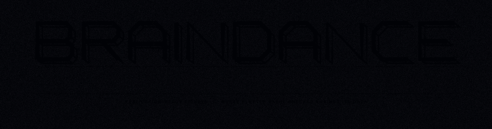
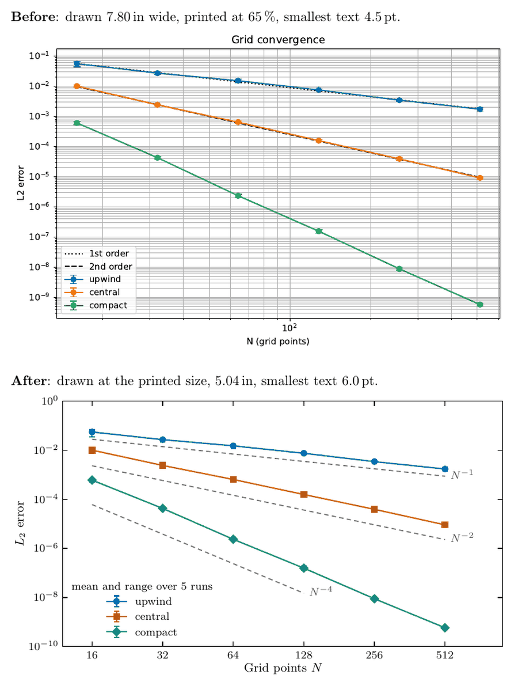

<p align="center"></p>

[](https://github.com/gbareas/braindance/actions/workflows/tests.yml)
[](LICENSE)

**Publication-ready matplotlib figures, with every plotted value checked against its source file.**

braindance sets a house style for scientific figures (LaTeX text, journal column widths, colourblind-safe colours, vector PDF) and runs measured checks that compare what is drawn with the data files it came from. It works as a plain Python package, and as a [Claude Code](https://claude.com/claude-code) plugin with a skill and a reviewer agent.



*Synthetic data. Each figure is shown as drawn first (old) and redrawn (new), both at the width the manuscript prints them. See the [full gallery](docs/gallery.md).*

## Install

```bash
pip install git+https://github.com/gbareas/braindance
```

Needs Python 3.10+, numpy, matplotlib and PyYAML. `poppler-utils` (`pdffonts`, `pdfinfo`) is used for the PDF checks, and LaTeX when present (otherwise matplotlib's mathtext with Computer Modern).

## Quick start

```python
import numpy as np
import matplotlib.pyplot as plt
from figproject import apply_style
from check_figure import check_figure

data = np.genfromtxt("spectrum.csv", delimiter=",", names=True)

apply_style()  # house style; LaTeX text if installed, else Computer Modern mathtext
fig, ax = plt.subplots(figsize=(3.4, 2.4))
ax.loglog(data["f_Hz"], data["S_V2_per_Hz"], ".", label="Data")
fig.savefig("figure.pdf")

check_figure(fig,
             sources=[{"label": "Data", "file": "spectrum.csv", "x": "f_Hz", "y": "S_V2_per_Hz"}],
             target={"width_in": 3.4}, pdf="figure.pdf", script=__file__)
```

The report says whether the values drawn equal the file, whether any point is hidden by the axis limits, and measures width, font sizes, overlaps and the fonts in the PDF. A full working example is in [`skills/latex-scientific-plots/example.py`](skills/latex-scientific-plots/example.py). Command line: `braindance-check --pdf figure.pdf --script plot.py --width 3.4`; for a LaTeX manuscript, `braindance-figs init path/to/main.tex`.

## As a Claude Code plugin

```
/plugin install braindance --marketplace gbareas/braindance
```

Or `claude plugin marketplace add gbareas/braindance` then `claude plugin install braindance@braindance`. Then ask Claude Code for a figure; the skill loads as `braindance:latex-scientific-plots`, and the `figure-reviewer` agent reviews the result.

## More

- [Features](docs/features.md): the checks, manuscript projects, chart choice and the review loop in detail
- [Before and after gallery](docs/gallery.md)
- [`SKILL.md`](skills/latex-scientific-plots/SKILL.md): the full rules the skill follows
- [Changelog](CHANGELOG.md) and [contributing](CONTRIBUTING.md)

## Status

Version 0.1. Still to come: a grader agent that reads the part of the manuscript citing a figure, checks of numbers written in heatmap and table cells, and schematics and diagrams.

Background: the project began as a study of the plotting agent of Google Research's [PaperOrchestra](https://github.com/google-research/paper-orchestra) (Apache-2.0), summarised in [`docs/reference-plotting-agent.md`](docs/reference-plotting-agent.md); none of its code is included. Chart-choice guidance is adapted from [From Data to Viz](https://www.data-to-viz.com) by Yan Holtz and Conor Healy (MIT). Colour cycle by Okabe and Ito.

## Licence

MIT, see [LICENSE](LICENSE).
