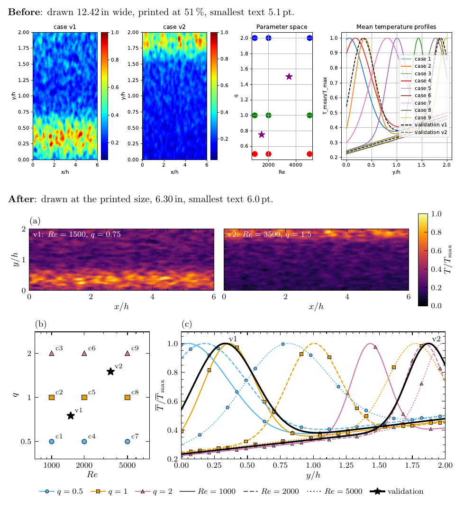
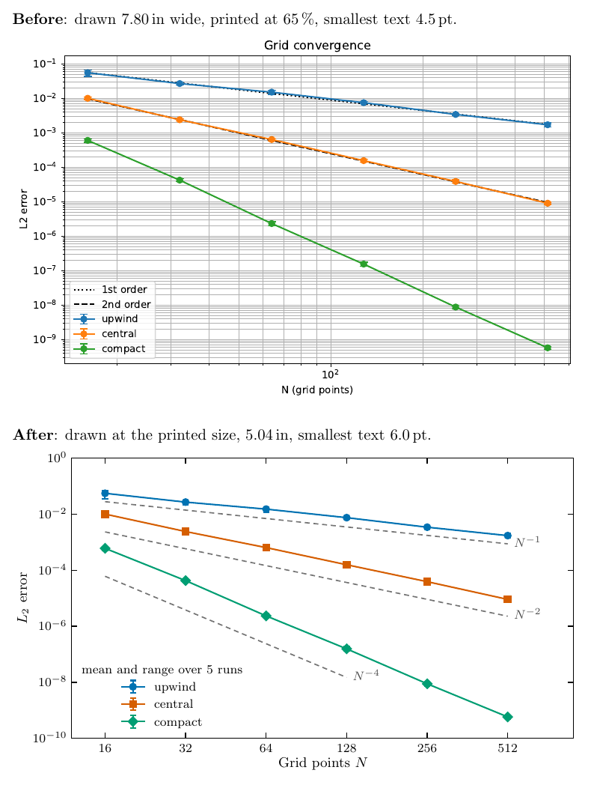
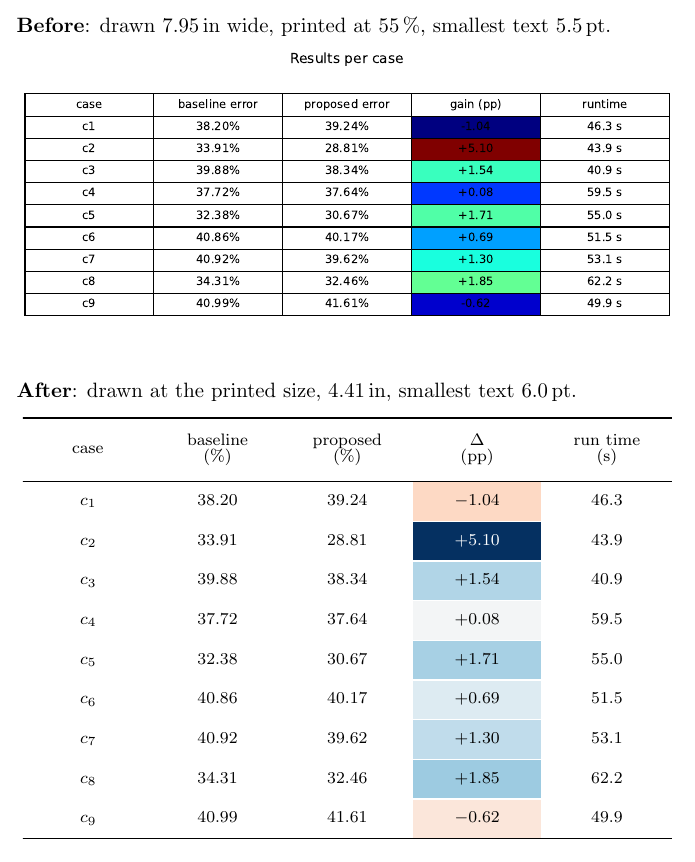
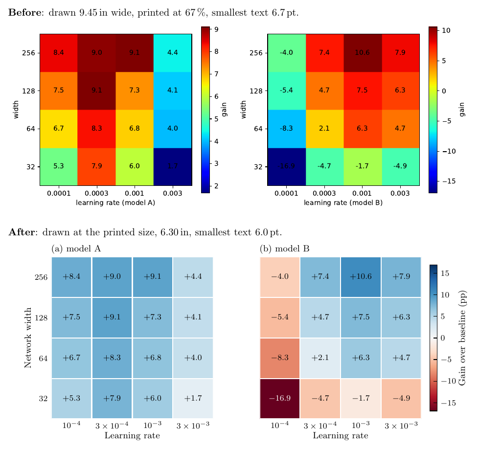

# Before and after

Four figures of a small synthetic manuscript, first as many drafts are drawn (matplotlib defaults, a large canvas shrunk to `\linewidth` by LaTeX), then redrawn from the same data with braindance. Each image shows the old figure above the new one, both at the width the manuscript prints them, so text sizes compare as a reader sees them on the page. All four new versions pass the measured checks with no warnings, including the comparison of every plotted value with its data. The data are synthetic; [`docs/examples/`](examples/) has the scripts, and `python docs/examples/build.py` rebuilds everything.

**Multi-panel overview.** Drawn 12.4 in wide and printed at 51 %, the original's smallest text is 5.1 pt. The new version is drawn at the printed width. It replaces the rainbow colormap with a perceptually uniform one and draws the fields at the true aspect ratio of the domain. One encoding runs through every panel: heating ratio as colour and marker, Reynolds number as line style, validation cases in black. A single legend replaces the one covering the profiles, and the cases are labelled on the points.

**Convergence study.** The new version puts ticks at the grid sizes that were run instead of a single 10², and labels the reference slopes on the lines. They are offset so they no longer hide the data. The legend states that the bars are the range over five runs. LaTeX text replaces the plain-text `L2 error` and the axes title.

**Table with colour.** The original is a matplotlib table printed at 55 % with a rainbow fill. The new version is set like a table in the paper: units in the headers instead of a % sign in every cell, rules instead of a grid, and case names typeset as in the text. The gain is coloured on a diverging scale centred on zero, so losses and gains read at a glance.

**Paired heatmaps.** The original gives each panel its own rainbow scale, so the same colour means different values in the two maps: green is about +5 in model A and about −5 in model B. The new version uses one diverging scale centred on zero for both, which shows that model B loses to the baseline at small widths. Each panel is named in its heading rather than in the axis label.

